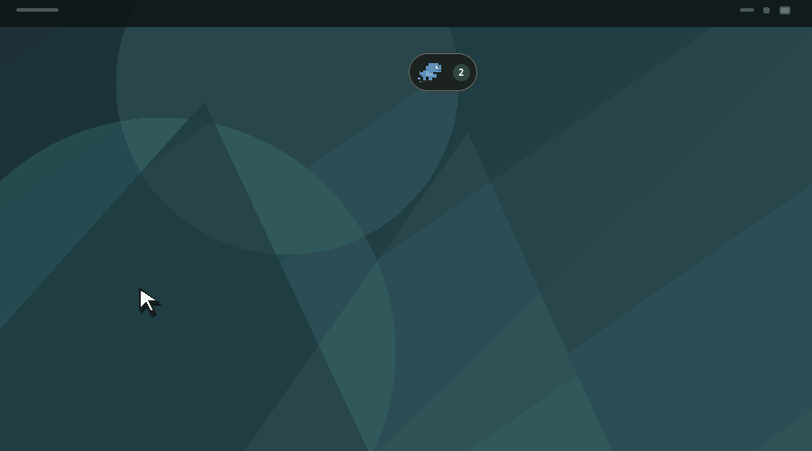
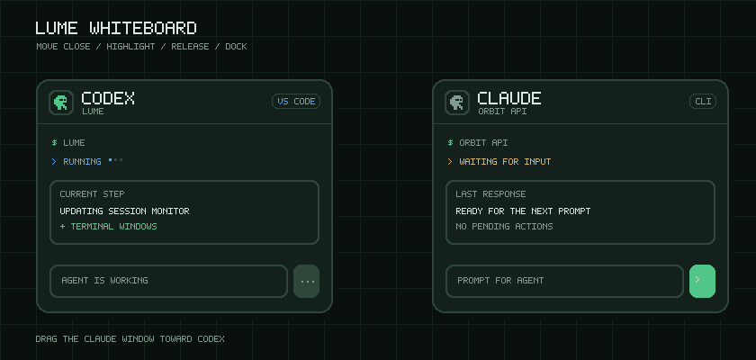
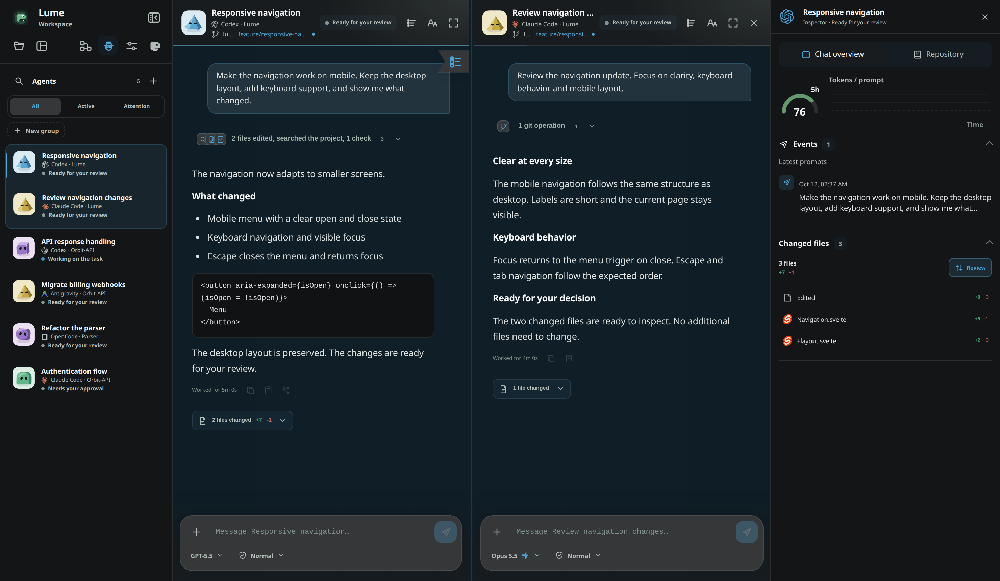
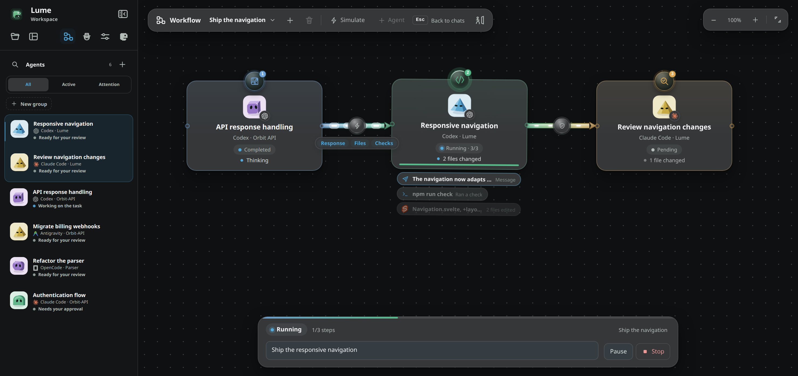

<p align="center">
  
</p>

<h1 align="center">Lume</h1>

<p align="center">
  Desktop app that monitors and controls AI coding agent sessions from one place.<br />
  Local-first: no account, no hosted service, no telemetry.
</p>

<p align="center">
  <a href="https://github.com/Lume-agents/Lume/releases/latest"><strong>Download</strong></a>
  · <a href="https://lumeagents.dev">lumeagents.dev</a>
  · Windows · Linux · macOS (preview) · Android
</p>

<p align="center">
  
</p>

Lume attaches to the agents you already run (Claude Code, Codex, Antigravity, OpenCode, Oh My Pi, and the web chats) through the channels each one exposes: hooks, process and session-file discovery, the Codex App Server, ACP, RPC. It normalizes what it finds into one session model with five states (`running`, `permission_required`, `waiting_for_input`, `completed`, `failed`) and puts that model behind several surfaces: the Orb, the Workspace, floating terminals, a workflow board, an Android app and, as a prototype, other computers.

It only offers an action when the source can actually perform it. A session that cannot answer a permission request shows the request and a link to its origin, never a button that pretends to.

```
 agents ─┬─ hooks (JSONL, 127.0.0.1:43119) ───────────┐
         ├─ process, rollout and transcript discovery ┤
         ├─ Codex App Server (43130 / 43131) ─────────┤
         ├─ OpenCode ACP · omp RPC · Claude CLI ──────┼─▶ normalized sessions ─▶ Orb · Workspace
         └─ Chromium Companion (43120) ───────────────┘                         Terminals · Workflow
                                                                                Mobile · Remote
```

## Orb

A capsule that starts collapsed and docks to any monitor edge, reshaping itself to the edge. Its color and counter follow the normalized states; expanded, it lists every session with agent, project, origin and state.

- Approve or deny supported permission requests, answer questions, continue a chat and read final responses without opening the Workspace.
- Per-monitor placement, a fullscreen guard (hidden over games and video unless you opt in) and the same session groups you create in the Workspace.
- Four notification tones (completed, failed, permission, usage) and desktop notifications, each switchable.
- Usage monitoring for Codex and Claude Code: a gauge per limit window, polled more often as a limit gets tight. A banner appears at 20% remaining, stays pinned under 10%, and a distinct tone plays when a limit is reached.
- Global command palette (`Ctrl+Shift+Space`) to jump between screens, sessions and actions.

## Floating terminals

Any monitored session can become its own window with the conversation, live activity, changed files, TO DO and GOAL progress, rate limits, image attachments and a prompt box. Windows move and resize freely, and dock horizontally or vertically into groups that move together while each stays an independent chat. The Whiteboard saves named layouts and restores them onto the matching open sessions.

<p align="center">
  
</p>

## Workspace

Up to three chats side by side plus an inspector, over the same sessions as the Orb.

<p align="center">
  
</p>
<p align="center"><sub>Illustrative sessions generated by <code>scripts/site-capture</code>, shown here with the Graphite base and the Ocean accent.</sub></p>

**Chat**
- Markdown, images, commands, changed files with diffs, TO DO and GOAL progress, plan documents and subagent timelines per session.
- Prompt queue and steer where the agent supports them; context meter and compaction; model, effort, Fast mode and permission mode per session, read from the agent itself.
- Slash commands come from the agent. Lume adds `/model`, `/clear`, `/mcp` (servers and their tools) and a few window commands. `Ctrl/Cmd+F` searches the chat.
- Each session keeps its own permission profile (access mode, approval policy, valid actions). A chat in plan mode and one with full access can sit side by side.

**Inspector**
- Token usage per prompt, recent prompts, events, rate limits and the MCP servers the agent has loaded, with connection status.
- Repository: working tree changes, commits, open pull requests and issues, HEAD checks and the last Actions runs. Git is read locally; GitHub reuses your own `gh` login and no token reaches the webview or an agent.
- A pull request or issue URL mentioned in a chat opens a preview with status, checks, labels and description. From the Changes tab you can commit the files you tick (staging only those, running your hooks). Lume never pushes.
- Session environments: the dev servers and databases each session started, with ports, uptime and a stop action tied to session, PID and start time. Association is by explicit identity (`CODEX_THREAD_ID`, a single confirmed owner of the process tree), never by path or timing.

**Review center**
- Per-file review with syntax-colored diffs, word-level highlights, folded context and a Git view of the working tree.
- Line comments can be sent back to the agent as a prompt; each result carries an approved / changes-requested decision.

**External CLIs stay untouched.** A Codex or Claude Code CLI you started yourself is monitored read-only until you explicitly transfer it to Lume, which resumes the same conversation.

## Workflow board

A canvas that chains sessions into a run. Each card is a session with a role (Planner, Implementer, Reviewer, Tester, Researcher or custom, each with an instruction, expected input, produced output and end condition). Each arrow sets what is handed over and whether to ask you first.

<p align="center">
  
</p>

- The runtime executes one linear chain: one arrow in and out per card, no loops, one first step, one route. A connection that breaks a rule is refused on the spot, with the reason.
- The handoff is a sanitized context package built from the source result (response, files, checks, plan or diffs, per the arrow's policy), not a copy of the conversation or of private reasoning.
- Runs are stored locally, survive a restart and resume against the original agent. Guardrails cover transitions, retries, step duration, sensitive handoffs and low rate limits. The last 200 runs are kept, with only the sanitized final response of each step.

Details in [docs/WORKFLOW_BOARD.md](docs/WORKFLOW_BOARD.md).

## Agent sources

| Source | Detection | What Lume can do |
| --- | --- | --- |
| Claude Code | Processes, hooks, native session registry | CLI sessions: monitoring. Sessions opened by Lume run without a terminal: prompts, permissions, model and effort, Fast mode, task list, MCP status |
| Codex (CLI and VS Code) | Processes, rollouts, hooks | External: monitoring. Controlled by Lume through the local App Server: prompts, queue, steer, approvals, model and effort |
| Antigravity CLI | `agy` processes, CLI-only hooks | Activity and status, model and permission selection, resume of the latest conversation per workspace |
| OpenCode | ACP server | Prompts, cancellation and slash commands |
| Oh My Pi (`omp`) | Processes, session files, optional extension | Controlled sessions over omp's RPC mode: prompts, steer and queue, interrupt, model and thinking, allow once or deny, questions, compaction. External sessions can be taken over after the terminal omp is closed |
| DeepSeek Harness, Gemini CLI (legacy) | Processes | Monitoring only; Gemini is never controlled |
| ChatGPT, Claude, DeepSeek, Gemini (web) | Chromium Companion | Status, final response and prompts while the page waits for input |

Transcripts stay where the agent wrote them; Lume reads them into memory while monitoring. Antigravity's hook auto-approves every tool call while installed, and Lume warns before enabling it. See [docs/AGENT_SOURCES.md](docs/AGENT_SOURCES.md).

## Remote and mobile

**Android.** The `Lume-Mobile.apk` in each release (also a PWA) pairs with the desktop over the local network. Enable **Settings → Mobile access** and scan the QR code. It is off by default, accepts only paired devices and encrypts payloads with keys derived from the one-time QR. Workflows are monitor-only on mobile.

**Other computers (prototype).** `lume node` runs a headless Node on a computer; another Lume pairs with it and reads its agents.
- Same network: mDNS discovery, HTTPS with a pinned certificate bound to an Ed25519 identity, and pairing by comparing a six-digit code on both screens.
- Other networks: the Node connects out to a Lume Relay ([source](https://github.com/Lume-agents/lume-relay), AGPL-3.0). Traffic is an Ed25519-authenticated X25519 session with ChaCha20-Poly1305, so the Relay carries ciphertext it cannot read.
- Paired devices are read-only: they see the session list and, only if the owner turns that switch on, the text of the conversation. Controlling a remote agent is not implemented. There are no accounts, and this has not had an independent security review.

See [docs/LUME_NODE.md](docs/LUME_NODE.md), [docs/LUME_REMOTE.md](docs/LUME_REMOTE.md) and the [threat model](docs/DISTRIBUTED_THREAT_MODEL.md).

## Install

The [latest release](https://github.com/Lume-agents/Lume/releases/latest) provides a Windows installer (`.exe`, which also puts `lume` on the `PATH`), `.deb`, `.rpm`, a portable Linux AppImage, and the Android app. Updates are signed and checked from **Settings → About**.

**macOS (preview).** Apple Silicon and macOS 15+. Until the build is signed ([#13](https://github.com/Lume-agents/Lume/issues/13)), install from the terminal, because Gatekeeper blocks the `.dmg`:

```bash
curl -fsSL https://raw.githubusercontent.com/Lume-agents/Lume/main/scripts/install-macos.sh | sh
```

Running it again updates to the latest release.

**Windows code signing.** Free code signing provided by [SignPath.io](https://signpath.io/), certificate by [SignPath Foundation](https://signpath.org/), once our application is approved. Until then the installer is unsigned and SmartScreen may warn. The [code signing policy](https://lumeagents.dev/code-signing/) says what is signed and who approves it.

**Connect your agents** in **Settings**. The first-run guide can install the agent CLIs and the GitHub CLI for you. After connecting Codex, run `/hooks` inside Codex and trust the **Lume** hook. The browser Companion is covered in [docs/AGENT_SOURCES.md](docs/AGENT_SOURCES.md), GitHub in [docs/GITHUB.md](docs/GITHUB.md), Linux display backends in [docs/DEVELOPMENT.md](docs/DEVELOPMENT.md).

## Customization

- Appearance: five accent themes, neutral dark (Graphite, Black, Slate) and light bases, custom accent color and opacity, bundled or custom UI and code fonts. English and Brazilian Portuguese.
- Per-project profiles: destination, monitor, orb position, permissions for new sessions, layout and preferred agents.
- External detectors: a JSON manifest adds a detector for another agent without a restart ([example](docs/external-plugin.example.json)).
- Shortcuts, all editable in **Settings → Keyboard shortcuts**:

| Action | Default |
| --- | --- |
| Open Lume | `Ctrl+Alt+Shift+L` |
| Command palette | `Ctrl+Shift+Space` |
| New session | `Ctrl+Alt+Shift+N` |
| Whiteboard | `Ctrl+Alt+Shift+B` |

## Privacy and data

Everything stays on the machine. The hook, Companion and Codex bridge ports are bound to loopback; the mobile gateway and a Node listen on the network only after you enable them. SQLite holds preferences, layouts, project profiles, workflow definitions and recovery state, saved notes, and a sanitized activity history. Permission requests are stripped before any write: no full command, path, tool input or payload. Live messages are not copied into a transcript database, and private model reasoning is never available to Lume. See [docs/PRIVACY.md](docs/PRIVACY.md) and [docs/PRODUCT.md](docs/PRODUCT.md).

## Development

Tauri 2 with a Rust backend (about 60 modules, 700+ unit tests), SvelteKit 5 frontend, SQLite through `rusqlite`, Capacitor for Android. CI runs on Windows, Linux and macOS.

```bash
npm install
npm run check        # type check and the frontend test suites
npm run tauri dev
```

Requirements: Node.js 22+, stable Rust and the Tauri system dependencies. [docs/DEVELOPMENT.md](docs/DEVELOPMENT.md) covers installers, releases and detectors; [CONTRIBUTING.md](CONTRIBUTING.md) the process. The marketing site is a separate private repository.
